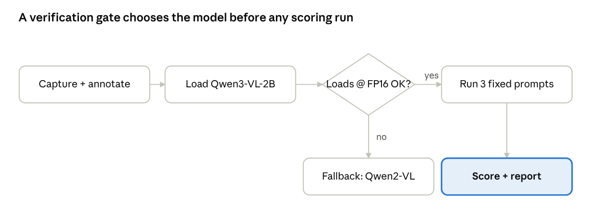

# RegionalPack-VLM: Research and Implementation Document

Oct 10, 2026 · @Moneeb Hussain

Implementation-ready research design for the Fatima Fellowship technical challenge and Moneeb's PhD outreach portfolio: a controlled evaluation of branded retail product recognition in a small open-weight vision-language model. Code generation follows this document, in Cursor, once confirmed.

## Scope & Research Question

This document is the locked research design and implementation specification for RegionalPack-VLM. It is not the Fatima README, not the GitHub README, and not the technical report; those are written from it in Phase 3 (see Research Report Requirements, Fatima Submission Checklist, and PhD Outreach Deliverables below). No code is generated from this document until it is confirmed.

**Project title (neutral):** RegionalPack-VLM: An Evaluation Protocol for Branded Retail Product Recognition in a Small Open-Weight Vision-Language Model.

**Research question:** When a small open-weight vision-language model is shown real photographs of branded retail packaging, does its accuracy at product-category recognition, brand identification, and packaging-text transcription differ between internationally distributed brands and Pakistan-local brands of the same product category, and where a difference exists, is it better explained by brand-name training frequency, packaging text legibility, or a tendency to assert a higher-frequency brand name instead of abstaining?

**Hypotheses (each independently testable, none presumed true):**

1.  **H1, frequency effect:** brand-identification accuracy differs between the two conditions even when category-recognition accuracy is similar, consistent with, not proof of, a training-frequency effect.

2.  **H2, legibility confound:** some or all of any accuracy difference is explained by packaging-text transcription accuracy differing between conditions, independent of brand identity.

3.  **H3, substitution pattern:** on incorrect brand identifications, the asserted wrong answer is disproportionately a well-known international brand name rather than a local brand name or a generic non-answer.

4.  **H4, assertion vs. abstention:** the model asserts a specific, incorrect brand name at a similar or higher rate than it hedges or declines, when it is wrong.

**What this design does and does not establish:**

- Matching product categories (cola to cola, biscuit to biscuit) controls for object type and task difficulty only. It does not isolate pretraining frequency from other differences between the two conditions, such as packaging text size, script, or design complexity, and it does not establish a causal geographic-bias claim. Any gap found is reported as associative and descriptive.

- At n = 16 to 20 products from one model, this is a product-level case study, not a claim about frontier models as a class. No significance test is run or reported.

- A result where the model performs comparably on both conditions is a valid, reportable outcome. The protocol is written to produce an informative result either way, see the Scoring Rubric below.

## Model Selection & Verification Protocol

**Selected model: Qwen/Qwen3-VL-2B-Instruct**, replacing the originally proposed Qwen2-VL-2B-Instruct. **Fallback: Qwen/Qwen2-VL-2B-Instruct**, used only for a confirmed technical incompatibility found in Phase 0, never for weak accuracy on any sub-task. See the switching rule below.

**Why Qwen3-VL-2B-Instruct, verified against its own documentation rather than assumed:**

- 2-billion-parameter dense vision-language model, within Fatima's 0.6 to 6B range, Apache 2.0 license.

- Its own model card describes it as the most powerful vision-language model in the Qwen series to date, the current flagship small VLM in an actively maintained family, which supports the defensible-proxy-for-frontier-capability argument Fatima's grading asks for.

- Documented improvements over Qwen2.5-VL: OCR expanded to 32 languages, up from 19, and explicit robustness to low light, blur, and tilt, matching real phone-photo conditions.

- Qwen2-VL-2B-Instruct has no equivalent documented OCR-language or capture-condition improvement.

**Precision, corrected, do not assume BF16 runs on the Colab free tier:** Qwen3-VL-2B-Instruct's published weights are BF16. Hardware bfloat16 computation requires an Ampere-or-newer GPU. Colab's free-tier GPU is a Tesla T4, which is Turing architecture and does not support bfloat16 computation; PyTorch raises a runtime error, current CUDA device does not support bfloat16, on Turing. The implementation loads the model with an explicit dtype=torch.float16 cast, not dtype="auto", on T4. FP16 and BF16 are both 16-bit formats, so VRAM usage should be a similar order of magnitude, roughly 4.6 to 4.8 GB by published estimates, but this is not assumed: Phase 0 measures actual VRAM with torch.cuda.max_memory_allocated() on the real Colab instance, logged in results/phase0_verification.md. FP16's narrower dynamic range than BF16 can also produce overflow or NaN output in some attention kernels; if that happens on T4 even after the explicit FP16 cast, it is logged as a genuine technical-incompatibility signal, see the switching rule below.

**Model-switching rule, technical incompatibility only:** switch to the Qwen2-VL-2B-Instruct fallback only if Qwen3-VL-2B-Instruct cannot run at all under reasonable troubleshooting, for example it fails to load, crashes, or produces NaN or garbage output across repeated attempts at FP16 on the actual Colab T4 instance. Weak or inaccurate Urdu-OCR output is not a switching trigger: if the model loads and runs correctly but reads Urdu poorly, that is a valid, reportable result in its own right, and the native-Urdu-script sub-task proceeds with Qwen3-VL-2B-Instruct regardless of how well it performs on it.

**Installation, verified and updated:** transformers\>=4.57.0 is now a stable PyPI release that supports Qwen3-VL, including follow-up patch releases with Qwen-VL-specific loading fixes. Install with pip install -U "transformers\>=4.57.0" as the primary path, and pin the exact resolved version in requirements.txt. Building from source, pip install git+https://github.com/huggingface/transformers, is a fallback only, used if the pinned stable release hits a specific loading bug, not the default instruction.

**Official Colab support:** an official Google Colab notebook link is published directly on the model card, so Colab compatibility is HF-documented, not only community-reported; Phase 0 still measures actual behavior on the free tier rather than trusting this alone.

**Phase 0 verification gate, run first, before committing to the full build:**

1.  In Colab, confirm the assigned GPU is a T4 with !nvidia-smi, then load Qwen3-VL-2B-Instruct with dtype=torch.float16 using the official quickstart snippet.

2.  Record actual peak VRAM used, torch.cuda.max_memory_allocated(), and confirm the model produces coherent, non-NaN output on a simple test image.

3.  Run the transcription prompt on 2 to 3 photos containing printed Urdu script and 2 to 3 containing Roman Urdu text, purely to record what the model actually does, not to decide whether to keep it.

4.  Record everything in results/phase0_verification.md: GPU confirmed, dtype used, peak VRAM, load success or failure, and the raw Urdu and Roman Urdu outputs with no judgment yet on whether they are good enough.

5.  **Decision rule:** proceed with Qwen3-VL-2B-Instruct whenever it loads and runs without crashing or producing NaN or garbage output at FP16, regardless of Urdu-OCR quality. Switch to the Qwen2-VL-2B-Instruct fallback only if it fails to load or produces unusable output after 45 minutes of troubleshooting at FP16. If the fallback is used, state the specific technical failure, never OCR quality, as the reason in the README's limitations section.

**Prior-work context for the model-choice justification**, used in the README to show awareness, not claimed as novelty: Western and geographic representation bias in vision-language training data is an active research area. Large-scale benchmarks built specifically to characterize Western bias in VLMs across many countries already exist, alongside documented findings that widely used vision-language datasets are disproportionately North American and European, and methods for estimating a vision-language model's accuracy on underrepresented, low-label domains. RegionalPack-VLM's narrower contribution, stated honestly rather than as a novelty claim, is extending this general finding to a domain that prior work does not cover: branded, text-bearing retail packaging, evaluated with a paired-category design and an explicit substitution-versus-abstention failure-mode analysis. Full citations are in the Sources section at the end of this document.

## Experimental Protocol & Design Limitations

**Dataset scope:** 16 to 20 products across 8 to 10 product categories, each category represented by one internationally distributed brand and one Pakistan-local brand (for example cola, biscuits, tea, milk, chips, detergent, toothpaste, juice). exactly 3 photographs per product, 48 to 60 images total.

**Category selection criteria, fixed before shooting, never adjusted afterward:**

1.  The category has a clear, commonly available international incumbent and a clear, commonly available Pakistan-local incumbent, both purchasable in an ordinary Lahore grocery store.

2.  The brand name or wordmark is visible somewhere on the primary packaging face.

3.  The product fits in a single photograph without being unpacked or opened.

Lock this list in data/product_list.md before any photography begins. A list finalized after seeing which photos worked cannot be defended as unbiased.

**Capture protocol, applied identically to every product:**

- Same phone camera, same indoor lighting setup, same plain background.

- Exactly 3 photos per product, fixed so the binary scoring below never ties: straight-on, a 30 to 45 degree tilt, and a closer crop showing partial occlusion, a hand, another item, or the frame edge. The same three angle types are shot for every product in both conditions.

- No retouching, no cropping to hide a legibility problem, no re-shooting a product after seeing the model's answer.

**Controls:**

- The category pairing controls for object type and holds task difficulty roughly constant.

- The fixed capture protocol controls for photo-quality confounds, lighting, angle, resolution, between conditions.

- Fixed prompt templates and fixed decoding settings, applied identically across every image (see Prompts, Decoding Settings & Scoring Rubric below), prevent prompt-tuning toward a hypothesis-confirming result.

- Evaluation order is randomized, not grouped by condition, so scoring is not biased by expecting a pattern partway through.

**Confounds this design does not control, stated explicitly rather than hidden:**

- Packaging text size and typographic clarity can differ between international and local brands independent of brand-name frequency. The OCR transcription score, see Scoring Rubric, is tracked separately from brand-identification accuracy specifically so this confound can be inspected, not ignored.

- Script differs: most international brands here use Latin script; several local brands carry Urdu script alongside Roman Urdu or English. This is part of what the project studies, not a controlled-away variable; the transcription task is scored per script type.

- Single annotator, the author, single model, 16 to 20 products: this is a descriptive pilot, not a validated benchmark. No inter-rater reliability figure exists at this scale, and this is stated plainly in the limitations section of every output, README, technical report, and Fatima submission.

- This design cannot separate a geography-specific effect from a general low-web-frequency-brand effect; a small, low-web-presence brand from any country might show the same pattern. The next experiment, named in Research Report Requirements and PhD Outreach Deliverables below, tests this directly by adding a third, non-regional niche-brand condition.

## Prompts, Decoding Settings & Scoring Rubric

**Exact prompts, applied verbatim, no per-image tuning:**

*Prompt 1, identification:* "What product is shown in this image? If you can identify the specific brand, name it. If you cannot identify the specific brand with confidence, say so explicitly rather than guessing."

*Prompt 2, transcription:* "Transcribe all text visible on the packaging exactly as written, including any text that is not in English. If no text is legible, say so."

*Prompt 3, category only, run separately to isolate category recognition from brand recognition for H1:* "What general category of product is this, for example beverage, snack, dairy, or cleaning product? Do not name a specific brand."

Prompt 1 already includes an uncertainty instruction rather than running a separate fourth how-confident-are-you prompt. A standalone self-reported-confidence prompt invites the model to narrate a confidence it may not actually have, which is the uncalibrated-confidence trap this document corrects. Confidence is measured from behavior, not self-report, see the abstention rule below.

**Decoding settings, identical for every call, logged in configs/inference_config.yaml:**

- temperature 0.1, top_p 1.0

- max_new_tokens 128 for identification and category, 256 for transcription

- Exact model revision, git commit hash or Hugging Face revision tag, pinned and recorded

- Exact transformers, torch, and CUDA versions recorded in requirements.txt

**Scoring rubric, product-level, not only image-level.** Every product has exactly 3 photos, straight, tilt, occluded, fixed specifically so binary fields have no ties under majority vote. Each field is scored per image first, then aggregated to one product-level value, see Product-Level Aggregation below.

**OCR scope, exact text region:** only the front-of-pack primary display panel counts, the brand wordmark, product or flavor name, and any prominent tagline on the main face of the package. Ingredient lists, nutrition tables, barcodes, and regulatory fine print are explicitly out of scope; they are a different, much harder transcription task and would conflate OCR difficulty with brand-level legibility. annotations.csv records ground truth for this region only, matching what Prompt 2 reasonably elicits.

**OCR normalization**, applied identically to ground truth and model output before scoring: Unicode NFC normalization; case-folding to lowercase for Latin-script text; strip leading, trailing, and repeated internal whitespace; strip punctuation that is not part of the brand name itself. Urdu-script presentation-form ligatures are normalized to their base character sequence where a standard normalization pass can do this reliably; a sample where normalization itself is ambiguous is excluded from the OCR score with the reason logged in the annotation notes, rather than forced into a number.

**OCR metric:** Character Error Rate, CER, the standard edit-distance-based metric used in OCR and ASR evaluation, Levenshtein distance between the normalized model output and the normalized ground truth, divided by the length of the ground truth. CER is computed separately for the Latin-script span and the Urdu-script span of a package when both are present, since mixing scripts into one edit-distance number would hide which one is actually driving a low score. Word Error Rate, WER, is reported as a secondary metric for Latin-script and Roman-Urdu text only; it is not reported for native Urdu script, where reliable automatic word segmentation cannot be assumed at this project's scale.

| Field             | How it's scored                                                                                                                                                                                           |
|-------------------|-----------------------------------------------------------------------------------------------------------------------------------------------------------------------------------------------------------|
| Category accuracy | Binary; correct if Prompt 3's answer names the right general category                                                                                                                                     |
| Brand accuracy    | Binary; correct if Prompt 1 names the exact brand or an unambiguous equivalent                                                                                                                            |
| OCR, Latin script | CER against the normalized ground truth, front-of-pack text only; WER reported alongside                                                                                                                  |
| OCR, Urdu script  | CER against the normalized ground truth, front-of-pack text only; WER not reported                                                                                                                        |
| Assertion type    | One of: correct, hedge-or-abstain, wrong-specific-international-brand, wrong-specific-local-brand, wrong-generic-or-unrelated; coded by the annotator reading the raw output, not the model's self-report |

**Product-level aggregation, tie handling, and multiple photographs, fixed before scoring begins and recorded in configs/scoring_config.yaml:**

- Category accuracy and brand accuracy: strict majority across the product's 3 photos, at least 2 of 3 correct counts as product-level correct. 3 photos is chosen specifically so this binary vote cannot tie.

- Assertion type: the modal value across the 3 photos. If all 3 photos produce 3 different assertion types, no majority exists; the product's assertion type is recorded as its own explicit category, inconsistent-across-photos, rather than forced into one of the five types. This is itself a reportable finding, not a scoring failure.

- OCR, CER and WER: not a vote. Report the mean and the range, minimum to maximum, across the product's 3 photos, separately per script. The range matters as much as the mean here: a product where CER swings from 0.1 to 0.9 across three ordinary angle changes says something different than one that holds steady, and averaging alone would hide that.

- Per-image scores are always retained in results/scored.csv alongside the product-level aggregate, so the aggregation itself stays auditable rather than discarding the raw per-image record.

**Objective abstention scoring:** the assertion-type field, at both the image level and the aggregated product level, is the primary abstention measure, scored from what the model actually did, asserted a specific wrong name versus hedged versus gave no answer, cross-tabulated against whether it was actually correct. This produces a breakdown of asserted-and-right, asserted-and-wrong, hedged-and-right, and hedged-and-wrong, reported as counts and percentages at n = 16 to 20 products, with no significance test and no claim that the model's verbalized hedge is a calibrated or reliable confidence score. The verbalized hedge is itself behavior being measured, not trusted as ground truth about the model's internal state.

**Qualitative error analysis:** every wrong or hedged answer gets one sentence of annotator commentary at the point of scoring, what it answered and which of H1 through H4 that instance speaks to, if any. This is what produces a what-it-got-wrong-and-why analysis instead of a single accuracy number.

## Dataset & Annotation Instructions

**Folder layout:**

data/  
product_list.md locked list of 16-20 products, categories, brand-origin label  
raw/  
\<product_id\>/  
straight.jpg  
tilt.jpg  
occluded.jpg  
annotations.csv ground truth, one row per image  
phase0_verification.md Phase 0 gate outcome, see Model Selection & Verification Protocol

**product_id convention:** \<category\>\_\<origin\>, for example cola_intl, cola_local, biscuit_intl, biscuit_local. Plain and descriptive, matching the naming convention already used across the rest of the portfolio: lowercase, underscored, names the thing rather than a codename.

**annotations.csv schema:**

| column          | description                                                                                                                    |
|-----------------|--------------------------------------------------------------------------------------------------------------------------------|
| image_path      | relative path under data/raw/                                                                                                  |
| product_id      | matches the folder convention above                                                                                            |
| category        | general product category, ground truth                                                                                         |
| origin          | international or local                                                                                                         |
| brand_true      | exact brand name as printed                                                                                                    |
| text_true_latin | ground-truth transcription of front-of-pack Latin-script text only, normalized per Prompts, Decoding Settings & Scoring Rubric |
| text_true_urdu  | ground-truth transcription of front-of-pack Urdu-script text only, normalized the same way; empty if none present              |
| script_present  | latin, urdu, roman_urdu, or mixed                                                                                              |
| angle           | straight, tilt, or occluded                                                                                                    |
| notes           | ambiguous cases: faded text, multiple name variants, anything a scorer should know                                             |

**Example row:** data/raw/cola_local/straight.jpg, cola_local, beverage, local, \<brand as printed\>, \<Latin text\>, \<Urdu text\>, mixed, straight, (empty)

**Annotation protocol:** annotate from the physical product or a clear reference photo, not from memory. Record exactly what is printed, not a corrected or standardized spelling. Flag any ambiguous case, faded text, multiple name variants on one package, in the notes column rather than silently picking one ground truth.

Only transcribe the front-of-pack primary display panel, matching the OCR scope fixed in Prompts, Decoding Settings & Scoring Rubric; ingredient lists, nutrition tables, and barcodes are out of scope and left blank.

## Code Architecture & Reproducibility

The pipeline runs in five stages, gated by the Phase 0 verification check before any scoring happens.

pipeline · 5 stages, 1 decision gate

On a Phase 0 fail, the pipeline swaps to Qwen2-VL-2B-Instruct and continues from the load stage; the fallback does not require reshooting or re-annotating the dataset.

**Repo structure:**

RegionalPack-VLM/  
data/ see Dataset & Annotation Instructions  
notebooks/  
evaluate.ipynb Colab notebook: loads model, runs inference.py, scoring.py end to end  
src/  
inference.py loads the model, runs the 3 fixed prompts per image, writes raw outputs  
scoring.py applies the scoring rubric against annotations.csv, writes scored.csv  
report_utils.py builds the figures from scored.csv  
prompts/  
prompts.yaml exact prompt text, single source of truth for inference.py and the README  
configs/  
inference_config.yaml model revision, dtype float16 on T4, decoding settings, library versions  
results/  
phase0_verification.md  
raw_predictions.jsonl append-only, one row per image per prompt, timestamped  
scored.csv product-level and image-level scores  
figures/  
accuracy_by_condition.png  
assertion_type_breakdown.png  
reports/  
technical_report.md see Research Report Requirements below  
README.md  
requirements.txt pinned exact versions

**Version-pinning & reproducibility checklist**, kept alongside the public Hugging Face Bucket, not instead of it:

- requirements.txt pins the exact resolved transformers version from the stable pip release actually used (4.57.x); a git commit hash is recorded only if the build-from-source fallback was needed.

- configs/inference_config.yaml records the exact Hugging Face model revision or commit for Qwen3-VL-2B-Instruct, or the fallback model, not only the model name.

- raw_predictions.jsonl is append-only and timestamped per run; a re-run never overwrites a prior run's raw outputs, so a discrepancy between two runs stays inspectable.

- The GitHub repo and the Hugging Face Bucket are kept in sync: the Bucket README links to the GitHub repo, and the GitHub README links to the Bucket, the dataset, and the model.

- The actual reproducibility test: a fresh clone, pip install -r requirements.txt, and running notebooks/evaluate.ipynb reproduces results/scored.csv from data/ and configs/ with no manual steps. A tidy folder structure alone does not satisfy this.

## Phased Implementation Plan

Target: 15 to 20 focused hours over 2 to 3 days. Phase 0 runs first on Day 1, before the shoot is treated as final, so a model swap costs no rework.

| Day | Task                                                      | Hours    | Output                                                                  |
|-----|-----------------------------------------------------------|----------|-------------------------------------------------------------------------|
| 1   | Lock product and category list                            | 1        | data/product_list.md                                                    |
| 1   | Phase 0 verification gate                                 | 1        | results/phase0_verification.md, model decision locked                   |
| 1   | Photograph all products                                   | 2        | data/raw/                                                               |
| 1   | Annotate ground truth                                     | 1        | data/annotations.csv                                                    |
| 1   | Set up Colab and inference harness                        | 1 to 1.5 | src/inference.py, notebooks/evaluate.ipynb skeleton                     |
| 2   | Run full evaluation batch                                 | 3        | results/raw_predictions.jsonl                                           |
| 2   | Score against ground truth, code error types              | 2        | results/scored.csv                                                      |
| 2   | Build figures                                             | 1        | figures/accuracy_by_condition.png, figures/assertion_type_breakdown.png |
| 3   | Write README answering Fatima Q1 and Q3                   | 2        | README.md                                                               |
| 3   | Write technical report                                    | 1        | reports/technical_report.md                                             |
| 3   | Push to GitHub, publish Hugging Face Bucket, verify links | 1        | public GitHub repo and Bucket                                           |
| 3   | Buffer                                                    | 1        | slack for Phase 0 troubleshooting or re-shoots                          |

Total: approximately 16 to 19 hours, within budget. If Phase 0 forces the fallback model, absorb it from the Day 3 buffer rather than cutting dataset size or scoring rigor.

**Explicitly out of scope for this phase** (see PhD Outreach Deliverables for when these become justified): a third, non-regional niche-brand control condition; any fine-tuning; a second full model evaluated in parallel; a dashboard or web front end.

## Research Report Requirements

reports/technical_report.md is the fuller write-up for professor sharing and interview preparation, distinct from the Fatima README, which stays short and answers only what Fatima's prompt asks. It contains, in this order:

1.  The locked research question and hypotheses, copied from Scope & Research Question above, unchanged.

2.  Method: dataset, capture protocol, prompts, scoring rubric, stated without hedging and without overclaiming, pointing back to this document's exact wording.

3.  Results, per hypothesis. H1 through H4 each get their own short subsection with the actual numbers, not folded into one accuracy table. Counts and percentages at n = 16 to 20; no significance test, no p-value, no claim of statistical confirmation.

4.  Qualitative error analysis: 3 to 5 of the clearest individual cases, with the image description, the model's actual output, and one or two sentences on what it suggests. A surprising or null result gets the same treatment as a confirming one, the same honesty standard already applied to the sim-to-real reversal in the camera-robust-recognition write-up.

5.  Limitations, copied forward from Experimental Protocol & Design Limitations, not softened for this audience.

6.  Path forward: the confidence-gated abstention proposal, CLIP similarity as an external out-of-distribution signal, not the generative model's own logits or verbalized confidence, named explicitly as speculative, with one concrete next experiment: the non-regional niche-brand control condition that would separate a frequency effect from a geography effect.

7.  One paragraph connecting this project to the FYP's own unresolved open-set-recognition gap, without overstating the connection to the other small research demos it sits alongside.

## Fatima Submission Checklist

- [ ] Phase 0 verification gate run and documented: GPU confirmed as T4, FP16 load and peak VRAM measured, model choice locked to Qwen3-VL-2B-Instruct unless a genuine technical failure occurred, never switched for Urdu-OCR quality alone

- [ ] 16 to 20 products photographed and annotated per the locked protocol

- [ ] Full evaluation run, raw outputs saved to results/raw_predictions.jsonl

- [ ] Scoring complete: category accuracy, brand accuracy, OCR score, assertion-type breakdown, reported per hypothesis H1 to H4

- [ ] Qualitative error analysis written for every wrong or hedged case

- [ ] README.md answers Fatima Q1, the blind spot from lived experience, and Q3, the path forward, each as its own focused section, not buried inside the technical report

- [ ] README states the model choice and the verification reasoning in one short paragraph

- [ ] README's limitations section stated plainly, with no overclaiming of novelty or generalizability

- [ ] Public Hugging Face Bucket created, containing the evaluation dataset, data/, the raw outputs, results/, and the README with the Q1 and Q3 answers

- [ ] Hugging Face Bucket link verified to actually be public, not merely unlisted, before submitting

- [ ] GitHub repo public, linked from the Bucket README and vice versa

- [ ] Link to the Hugging Face Bucket included in the actual Fatima submission form

## PhD Outreach Deliverables

What this project produces beyond Fatima, and how to frame it:

- A GitHub repo named plainly, RegionalPack-VLM, matching the naming convention of camera-robust-recognition and the rest of the portfolio, citable in cold emails to open-set-recognition, vision-reliability, and representation or dataset-bias-aware professors.

- A one-line outreach pitch: extends the confident-misclassification-under-distribution-shift question from the FYP and the open-set-flagging project to a frontier-class open-weight vision-language model. Never framed as a bias, fairness, or DEI study in outreach language; the vocabulary stays technical, distribution shift, abstention, representation frequency.

- The technical report, reports/technical_report.md, as the document to send if a professor asks for more detail after a first reply, the same role the camera-robust-recognition write-up played with Prof. Zhong.

- One interview-ready narrative, in order: the question came from a limitation found in my own FYP; I built a controlled, paired comparison rather than a demo; here is what the result actually was, including anything that did not confirm the hypothesis; here is what I would check next and why; here is what I would need before claiming anything stronger.

- Phase 2, built only if Phase 1's findings justify it, not as a default next step: the non-regional niche-brand isolation condition named in Research Report Requirements, and a small working CLIP-similarity abstention-gate proof of concept, which would directly extend the already-planned open-set-flagging-project design. Either of these, done well, is a stronger PhD-portfolio artifact than starting a new, unrelated small project; this document does not recommend the latter before deciding whether to deepen this one.

## Sources

As of 2026-10-10.

- [Qwen/Qwen3-VL-2B-Instruct model card](https://huggingface.co/Qwen/Qwen3-VL-2B-Instruct), parameter count, license, OCR language count, official Colab notebook link

- [Qwen3-VL-Embedding & Reranker language list](https://github.com/QwenLM/Qwen3-VL-Embedding), sibling model's published 33-language list naming Urdu; not confirmed to match the instruct model's own OCR list

- [Qwen3-VL-2B-Instruct GPU requirements](https://www.spheron.network/tools/gpu-recommender/Qwen/Qwen3-VL-2B-Instruct/) and [hardware guide](https://llmrun.dev/model/qwen-qwen3-vl-2b-instruct), published BF16 inference VRAM estimates; Phase 0 measures the actual figure on T4 at FP16 rather than relying on these

- [Qwen3-VL release notes](https://registry.ollama.ai/blog/qwen3-vl), the 32-language OCR expansion and low-light, blur, and tilt robustness claims

- [PyTorch forum: Tesla T4 does not support bfloat16](https://discuss.pytorch.org/t/current-cuda-device-does-not-support-bfloat16-please-switch-dtype-to-float16/201564), confirms bfloat16 requires Ampere or newer and that Turing GPUs including the T4 raise a runtime error on bf16

- [transformers releases](https://github.com/huggingface/transformers/releases) and [Qwen3-VL-2B-Thinking model card commit confirming 4.57.0 shipped](https://huggingface.co/Qwen/Qwen3-VL-2B-Thinking/commit/8b5ad6bf5c6727a7d6c2ad97b3b6a726778d4690), current install guidance

- [CultureVLM / CultureVerse](https://arxiv.org/abs/2501.01282), a large-scale benchmark characterizing Western bias in vision-language models across many countries

- [Culture Affordance Atlas](https://arxiv.org/abs/2512.03173), representation bias in LAION-5B, COCO, and ImageNet toward North America and Europe

- [Underrepresented in Foundation Model Pretraining Data? A One-Shot Probe](https://arxiv.org/abs/2603.04346), the closest prior method for estimating a vision-language model's accuracy on underrepresented, low-label Global South domains
