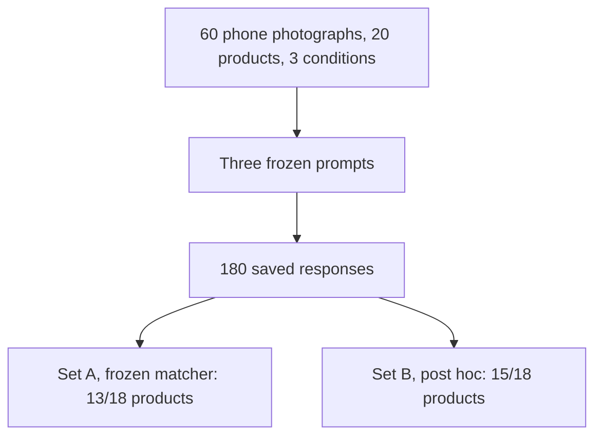

# RegionalPack-VLM: brand identification, packaging transcription, and category recognition in a small vision-language model

Moneeb Hussain · Version 0.1 · 12 October 2026

## Abstract

I evaluated Qwen3-VL-2B-Instruct on 60 phone photographs of 20 branded retail packages from a Lahore, Pakistan shelf. Each product was photographed straight-on, tilted, and partly occluded. Nine category pairs, 18 products, form the primary comparison. An apple-drink pair is exploratory and is excluded from the primary rates. The model received three frozen prompts on every photograph: specific product-line identification, front-of-pack transcription, and general category. All 180 calls completed. The model was not fine-tuned.

A product counts as correct when at least two of its three photographs succeed. Under the frozen automatic brand matcher, Set A, 13 of 18 primary products are correct (72.2%). After I reviewed five image-level answers, Set B, which is post hoc and does not replace Set A, is 15 of 18 (83.3%). Frozen category accuracy is 14 of 18. The clearest result is that a usable transcription and a committed product-line name are not the same decision. CandyLand YOU is transcribed with Latin character error 0.00 on all three frames, and the identification answer still abstains. These origin counts describe this shelf. They do not establish that product origin or pretraining frequency caused the difference.

## 1. Introduction

I built an automated checkout for a moving retail conveyor as a final-year project. The detector was YOLOv4-tiny, and OpenCV handled the camera and the belt. I collected about 3,500 images across 70 products. Inside that fixed class list the system could name a pack. Unknown products had no dedicated, validated open-set rejection mechanism. A confidence threshold can yield no detection, so the detector was not forced to name a trained class on every frame. What that system lacked was a tested refusal for an unfamiliar pack.

Shelves in Pakistan carry both internationally distributed brands and brands sold for the Pakistan market. I wanted to know whether a small open-weight vision-language model, shown ordinary phone photographs, would keep three judgments apart: reading the front of the pack, naming a general category, and committing to the specific product line. I am not claiming that the checkout detector and Qwen3-VL fail by the same mechanism. The checkout model could only emit classes it had been trained on. This study asks a related question of a model that can also transcribe and abstain in language.

I designed the comparison, photographed the packs, verified the transcriptions, and ran the evaluation. No second annotator and no second model are part of Version 0.1.

## 2. Research questions

The question I locked before the run is whether category recognition, specific brand identification, and packaging-text transcription differ between internationally distributed brands and Pakistan-market brands of the same category, and whether any difference is better described by name frequency, text legibility, or a habit of asserting a familiar name instead of abstaining.

The hypotheses, which I did not revise after seeing the answers, are:

1. **H1.** Brand-identification accuracy differs between the two groups even when category accuracy is similar. That pattern would be consistent with a frequency effect. It would not prove one.
2. **H2.** Some or all of any brand difference is explained by transcription accuracy differing between the groups.
3. **H3.** When the brand is wrong, the asserted name is disproportionately a well-known international brand.
4. **H4.** When the brand is wrong, a specific incorrect name is at least as common as a hedge or an abstention.

The design records an association on one shelf. I did not measure how often a name appeared in pretraining, and the results do not support a causal claim about geographic origin.

## 3. Related work

Liu, Jin, Li, Wong, Wen, Sun, Chen, Xie, and Wang evaluate 16 vision-language models on CultureVerse and report stronger performance on Western concepts than on African and Asian contexts ([CultureVLM](https://arxiv.org/abs/2501.01282), arXiv:2501.01282, 2025). Nwatu, Bai, Ignat, and Mihalcea describe a higher-income, Western skew in mainstream vision-language data and point to earlier measurements of North American and European concentration in LAION-5B, COCO, and ImageNet. Their own contribution is a function-based reannotation of Dollar Street ([Culture Affordance Atlas](https://arxiv.org/abs/2512.03173), arXiv:2512.03173). Vorster, Maniparambil, O’Connor, Murphy, and Molloy predict a vision-language model’s zero-shot accuracy on a target domain from one labeled image per class, including underrepresented domains ([One-Shot Probe](https://arxiv.org/abs/2603.04346), arXiv:2603.04346, 2026). I do not estimate pretraining frequency, and I do not use that probe. This study is narrower: one 2B model, paired retail packages, and three scored outputs.

## 4. Dataset

I photographed 20 products in Lahore, three phone frames each: straight, tilt, and occluded. Those words name capture conditions. They are not a controlled viewpoint experiment. Nine categories contribute one international product and one Pakistan-market product: cola, biscuit, tea, chocolate, chips, detergent, toothpaste, noodles, and soap. The apple-drink pair, Fruita Vitals and Fruitien, is exploratory. I exclude it from the primary rates, which leaves 18 products and 54 primary photographs.

Pairs share a category. They are not matched variants. Filling, flavor, gel claim, fragrance, and drink style differ, and I recorded those differences on the manifest. I verified all 60 transcriptions before inference. The scored reference keeps the visible brand, the product or flavor, and the prominent tagline. I left prices, nutrition tables, and tiny regulatory lines out of the reference on purpose.

## 5. Methodology

Every photograph received the same three prompts.

- **Identification** asks for the specific brand and tells the model to say so when it cannot.
- **Category** asks for a general category, with “cleaning product” given as an example, and tells the model not to name a brand.
- **Transcription** asks only for the front face: brand wordmark, product or flavor, and prominent tagline, including text that is not in English. It tells the model to skip ingredient lists, nutrition tables, barcodes, and regulatory fine print.

I fixed that transcription wording in `prompts/prompts.yaml` before this evaluation and did not change it after the responses were saved. The historical specification, `docs/research_spec.md`, still quotes an older “Transcribe all text” sentence. I left that file unchanged. The Phase 0 wording is archived in `prompts/phase0_prompts.yaml` and was not the prompt I sent. The record is [PROMPT_PROVENANCE.md](PROMPT_PROVENANCE.md).

I loaded Qwen/Qwen3-VL-2B-Instruct in float16 on a Tesla T4 with SDPA attention. The pinned revision `89644892e4d85e24eaac8bacfd4f463576704203` matched the cached snapshot. Decoding was temperature 0.1, top_p 1.0, seed 0, and batch size 1. The run saved 180 responses and 0 errors. I did not fine-tune the model, and I have not rerun it.

## 6. Evaluation protocol

Brand identification, packaging OCR, and category recognition are three separate scores. A correct transcription is not a brand hit. A correct category is not a brand hit. A parent-company name is not the product line.

| Term                     | Meaning in this study                                                                                                 | Example                                                          |
| ------------------------ | --------------------------------------------------------------------------------------------------------------------- | ---------------------------------------------------------------- |
| Parent or umbrella brand | Company or house name stored in `parent_names`. It is metadata and is not an accepted answer by itself.               | Bisconni on the Rite biscuit. CandyLand on the YOU bar.          |
| Specific product line    | The name I am scoring.                                                                                                | Rite. YOU. Super Crisp.                                          |
| Accepted answer          | Set A: the response contains a frozen alias as its own words. Set B, post hoc: my written adjudication of that image. | `YOU` and `CandyLand YOU` are aliases. `CandyLand` alone is not. |

A product is correct when at least 2 of 3 photographs are accepted. Fewer than three decided photographs would be incomplete, not incorrect. Character error rate is Levenshtein distance divided by the length of my transcription, after Unicode NFC, collapsed whitespace, and Latin casefold. Punctuation stays. Urdu is scored only where the reference is non-empty, and I do not report an Urdu word-error rate.

**Set A** is the frozen automatic matcher. I did not change its aliases, punctuation rule, or category list after seeing the answers. **Set B** is a post-hoc reading of the same saved answers. I decided it after reviewing the responses. It does not replace Set A. On 12 October 2026 I approved the five image decisions that move the product majority from 13/18 to 15/18. Those decisions are in [ADJUDICATION_APPROVAL.md](ADJUDICATION_APPROVAL.md).

**Bisconni Rite.** The accepted product line is Rite. Bisconni is the parent. Set A hits only the tilt frame, because a trailing period is stripped and the word Rite then matches, even though that answer assigns the brand to Biscotti. I rejected that frame in Set B. The other two frames already miss, so the product stays a miss in both analyses.

**CandyLand YOU.** The accepted strings are YOU and CandyLand YOU. CandyLand alone is not an alias. All three identification answers abstain. Quoting `you MILK CHOCOLATE` does not become an accepted identification. Both analyses miss all three frames.

## 7. Results

| Analysis                                | Result                 | Denominator                                                                 |
| --------------------------------------- | ---------------------- | --------------------------------------------------------------------------- |
| Set A brand, product majority           | 13/18 (72.2%)          | 18 primary products. Wilson 95% interval 49%–88%                            |
| Set A brand, photographs                | 42/54 (77.8%)          | 54 primary photographs. The three frames of one product are not independent |
| Set B brand, product majority, post hoc | 15/18 (83.3%)          | Same 18 products. Wilson 95% interval 61%–94%                               |
| Set B brand, photographs, post hoc      | 45/54 (83.3%)          | Same 54 photographs                                                         |
| Frozen category, product majority       | 14/18 (77.8%)          | 18 primary products                                                         |
| Latin CER                               | median 0.69, mean 5.22 | 60 images                                                                   |
| Urdu CER                                | median 2.14, mean 4.91 | 9 images                                                                    |

Set A origin counts are 9/9 international and 4/9 Pakistan-market. Set B, post hoc, origin counts are 9/9 and 6/9. The move from 13/18 to 15/18 is Bonus Tristar and Shoop. Frozen category counts are 7/9 in each origin group. Figures: [figures/brand_by_origin.svg](figures/brand_by_origin.svg) and [figures/brand_by_capture_set_a.svg](figures/brand_by_capture_set_a.svg). The capture chart is Set A only: straight 13 of 18, tilt 15 of 18, and occluded 14 of 18 photographs.

**H1.** In this sample the brand majorities differ across the two origin groups, and the frozen category majorities match at 7/9 and 7/9. That is the shape H1 described. It describes these 18 products. Both origins lose soap and toothpaste for the same “cleaning product” answer, so the category match is also an accept-list result. I did not measure pretraining frequency, and the pairs are not matched packages.

**H2.** Transcription error cannot explain every identification failure, and this run does not identify the remaining cause. Primary Latin character error, 27 photographs in each group, has international mean 9.85 and median 0.46, and Pakistan-market mean 1.34 and median 0.77. The international mean is dominated by one repeated Knorr transcription. The medians do not show a Pakistan-market legibility disadvantage. CandyLand YOU has Latin character error 0.00 on all three frames and is still an identification abstention.

**H3.** The brand misses are not substitutions of a famous international name. The Set B misses are CandyLand YOU and Super Crisp, both abstentions, and Bisconni Rite, where the stated brand is Bisconni or the spelling Biscotti. No primary failure is the model saying “Coca-Cola” or “Lay’s” for a Pakistan-market pack.

**H4.** Explicit abstention is common among the identification failures. Six primary identification answers say the brand cannot be identified. Three Rite answers assign the brand to the parent. The tilt Bonus answer names the right brand and the wrong product type. A wrong specific international brand is not the typical failure in this run.

### Identification and transcription on the same photographs

| Photograph                 | Transcription                                                       | Latin CER | Identification                                                                 | Set A | Set B, post hoc |
| -------------------------- | ------------------------------------------------------------------- | --------- | ------------------------------------------------------------------------------ | ----- | --------------- |
| `chocolate_local/straight` | `you / MILK / CHOCOLATE`, matching the reference                    | 0.00      | Quotes `you MILK CHOCOLATE` and says the specific brand cannot be identified   | miss  | miss            |
| `chips_local/straight`     | `SUPER CRISP` plus flavor and nutrition lines outside the reference | 0.72      | Quotes `Super Crisp`, then says the specific brand is not clearly identifiable | miss  | miss            |
| `biscuit_local/straight`   | `BISCONNI / Rite` and the cream tagline                             | 0.00      | “The specific brand name is Bisconni.”                                         | miss  | miss            |
| `biscuit_local/tilt`       | Same reference words, character error 0.00                          | 0.00      | Brand assigned to Biscotti; Rite called a flavor and the product name          | hit   | miss            |
| `noodles_intl/tilt`        | `Knorr`, then `NO added preservatives` repeated                     | 221.00    | “Knorr Chicken instant noodles.”                                               | hit   | hit             |

The other two YOU (chocolate) frames also have Latin character error 0.00 and abstain. The tilt YOU identification does not quote the wordmark; its transcription still reads `you / MILK / CHOCOLATE`. The tilt and occluded Super Crisp answers abstain without the name, while those transcriptions still contain `SUPER CRISP`. The full strings are in [../results/scored_predictions.csv](../results/scored_predictions.csv).

The Knorr row is the opposite disagreement: the product line is identified, and the transcription is not usable. Bonus Tristar’s tilt identification names the brand and calls the packet sugar-free gum. The category answer for that same frame says cleaning product, which the frozen detergent list accepts. Brand, product type, and category are three judgments on one photograph.

### OCR

The recorded rates mix a missing reference word with extra text the reference excluded. Prices, nutrition lines, and regulatory text were left out of my transcription on purpose. If the model prints them, every extra character is an insertion. Insertions increase the numerator and not the denominator, so the rate can exceed 1. I treat that as an extraction-scope error. A missing or replaced reference word is a transcription error. A proposed split between those counts is in [OCR_METRIC_INTERPRETATION.md](OCR_METRIC_INTERPRETATION.md). I have not computed it as a replacement endpoint, and I did not delete model text to improve the rate.

The Latin mean, 5.22 on 60 images, includes `noodles_intl/tilt` at 221.00, where one line is repeated 46 times. The median is 0.69. The mean with repeated-line images removed is 1.56 on 59 images. That removal is a sensitivity. The recorded mean still includes the row. Urdu is 9 photographs: three each of Surf Excel, Bonus Tristar, and Shoop. Median 2.14, mean 4.91. The three Shoop transcriptions omit the Urdu reference `چٹ پٹا`.

### Category

Frozen category accuracy is 14/18. All 11 photograph-level category misses, on soap and toothpaste, answer “This is a cleaning product.” That phrase is an example in the category prompt. The frozen accept list includes it for detergent and not for soap or toothpaste. I did not change the list after the run. If those broad answers were also accepted, the product majority would be 18/18. That figure is not the frozen accuracy.

## 8. Discussion

The result I would carry forward is the split between channels. The model can transcribe a product line, or even quote it, and still abstain from naming it. It can also assign the brand role to a parent company while the product-line word is in the transcription. Set B changes the product majority only for Bonus Tristar and Shoop, where the name is explicit and the frozen matcher missed it because a quotation mark stayed attached to the word. Rite remains a miss in both analyses because the stated brand is the parent.

The origin counts have the shape H1 described, and the category rates are similar. I do not read that shape as evidence that origin or pretraining frequency caused the gap. The sample is 18 selected products. The Wilson intervals are wide, and they are not significance tests. The pairs differ in flavor, filling, gel claim, fragrance, script, and layout. The international product is also the more globally familiar name. Familiarity and origin move together in this set, and I did not measure frequency.

## 9. Limitations

One model, one annotator, and 18 primary products. Phone angles are not a viewpoint experiment. The frozen matcher does not treat a comma or a quotation mark as a word boundary, which is why Set B exists and why it is labeled post hoc. Urdu is nine images. The secondary OCR split, reading coverage against extraction-scope surplus, is specified and not yet computed. No significance test is reported.

## 10. Conclusion

On this shelf, Qwen3-VL-2B-Instruct’s category answers and its product-line commitments do not move together, and a correct front-of-pack transcription does not settle the brand decision. Set A is 13/18. Set B, post hoc, is 15/18. I would not fine-tune on these 60 photographs. The next study I would run, and have not run, has four parts: matched photographs of Pakistani product lines and of less globally familiar non-Pakistani product lines; separate records for transcription, a candidate product line, and abstention; a calibrated image-text similarity score, or another external check, as an abstention gate; and a held-out evaluation of both correct recognition and safe abstention. The model’s sentence “I cannot identify the brand” is behavior to be scored, not that gate.

## References

- Shudong Liu, Yiqiao Jin, Cheng Li, Derek F. Wong, Qingsong Wen, Lichao Sun, Haipeng Chen, Xing Xie, and Jindong Wang. CultureVLM: Characterizing and Improving Cultural Understanding of Vision-Language Models for over 100 Countries. arXiv:2501.01282, 2025. [https://arxiv.org/abs/2501.01282](https://arxiv.org/abs/2501.01282)
- Joan Nwatu, Longju Bai, Oana Ignat, and Rada Mihalcea. Culture Affordance Atlas: Reconciling Object Diversity Through Functional Mapping. arXiv:2512.03173. [https://arxiv.org/abs/2512.03173](https://arxiv.org/abs/2512.03173)
- Chris Vorster, Mayug Maniparambil, Noel E. O’Connor, Noel Murphy, and Derek Molloy. Underrepresented in Foundation Model Pretraining Data? A One-Shot Probe. arXiv:2603.04346, 2026. [https://arxiv.org/abs/2603.04346](https://arxiv.org/abs/2603.04346)
- Qwen Team. Qwen3-VL-2B-Instruct, revision `89644892e4d85e24eaac8bacfd4f463576704203`. [https://huggingface.co/Qwen/Qwen3-VL-2B-Instruct](https://huggingface.co/Qwen/Qwen3-VL-2B-Instruct)

